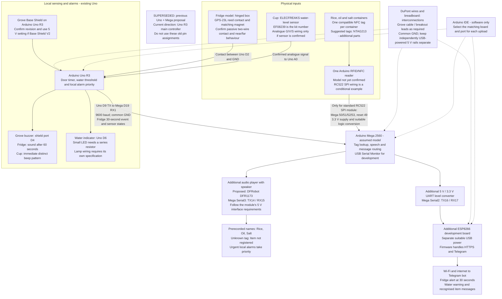

# VIK: overview, wiring plan and build sequence

**Revision notice — 3 November 2026:** The group now prefers the Uno R3 as the main controller and does not require the Mega. The two-board layout and pin tables below are superseded reference material; do not wire the project from them. The revised direction is Uno R3 for sensing, identification and local outputs, an ESP8266 for network communication, and a suitable audio playback module for speech. Reader/audio interfaces must be confirmed before the new Uno pin map is finalised. NTAG213 NFC tags are recommended for Arduino and phone use. For the door contact, specify electrically closed with the magnet near and open when it is far, and verify that behaviour rather than relying only on a seller's NO/NC label. A small LED needs its series resistor.

Prepared 3 November 2026. This is a proposed build guide, not a tested circuit or working firmware package.

## 1. Purpose and expected behaviour

Develop an Arduino-based kitchen assistance prototype for people with low vision. It combines three tasks:

| Task | Input | Local response | Remote response |
|---|---|---|---|
| Fridge door left open | A magnetic contact on a hinged model-fridge box | At 60 seconds continuously open, sound the buzzer until the door closes | At 30 seconds continuously open, send one Telegram message |
| Cup approaching overflow | A liquid-level sensor clipped at the selected warning position | Immediately activate the water LED and a recognisable buzzer pattern | Send one Telegram message per filling event |
| Container identification | Present one tagged container to a fixed reader | Look up the tag ID, print the name if Serial Monitor is connected, and play the matching recorded item name | Send the identified name to Telegram |

Water warnings take priority over fridge beeps. Item speech should be deferred or stopped while an urgent local alarm is sounding; ask the user to rescan after resolving the alarm so a stale name is not spoken later. Neither an LED nor a phone notification is the sole cue for a person who cannot see it.

The system gives warnings, not automatic door closure or water shut-off. Tagged containers identify stored labels, not their actual contents. Keep labels up to date when refilling.

## 2. Why use both boards in this version?

Use the **Uno R3 for fridge/water sensing and local alarms**, with the Grove shield on the Uno. Use the **Mega for RFID/NFC, audio and communication**. This keeps the Uno directly involved in the project and separates local alarms from network delays.

This assumes your Mega is a standard **Mega 2560**. Its extra hardware serial ports make it suitable for the additional modules. Mega-only is electrically simpler if your course permits it, but this guide preserves the Uno role specified in the assignment. Do not transfer these Mega pin assignments to the Uno.

The assignment mentions Arduino Uno explicitly in the individual lesson. It does not establish whether a Mega-only project is acceptable. The original assignment PDF remains unchanged.

References: [Mega board](https://docs.arduino.cc/hardware/mega-2560/), [official Mega pinout](https://docs.arduino.cc/resources/pinouts/A000067-full-pinout.pdf).

## 3. Inventory: what each listed item does

| Listed item | Use / qualification |
|---|---|
| Arduino Uno R3 | Door and water sensing; buzzer/LED; sends state changes to Mega |
| Arduino Mega | Proposed communications and identification controller; confirm Mega 2560 |
| DuPont wires | Signal and common-ground connections; confirm male/female ends match headers |
| GPS-23L | Treat as a door contact only after confirming it is a passive two-wire magnetic switch. A matching magnet is also required |
| Arduino RFID/NFC reader | Identify the exact board before wiring. RC522 and PN532 boards have different interfaces and supply arrangements |
| EF08239 water sensor | EF08239 identifies the Wonder Building Kit, not an individual sensor model. Check the actual sensor label |
| Grove buzzer | Local beeps. It cannot pronounce item names |
| Grove Base Shield | Connect Grove modules to the Uno. Confirm revision and connector labels |
| LED light bulb | The example below is for a small indicator LED or a documented low-voltage module. A household bulb is not interchangeable |
| Breadboard | Temporary connections and resistors; some boards have split power rails |
| Arduino IDE | Development software, not a physical circuit component |
| Telegram bot | Existing online identity. It does not connect sensors by itself; firmware must call its API |

## 4. Additional parts required for the complete feature set

1. **Wi-Fi hardware:** an ESP8266 development board, such as a NodeMCU-style board, with a suitable USB cable and regulated supply. Neither the Uno R3 nor the ordinary Mega 2560 includes Wi-Fi.
2. **Audio hardware:** a playback module and speaker. A proposed compact option is **DFRobot DFR1173**, which includes storage and a speaker. This guide reserves Mega Serial3 for it. If you buy DFPlayer Mini instead, its wiring, speaker, microSD requirements and library differ; do not interchange the instructions.
3. **Container tags:** at least three matching tags. NTAG213 is a suggested choice for Arduino and NFC-enabled phones, provided the chosen reader supports it.
4. **Voltage conversion:** a suitable 5 V/3.3 V UART interface for ESP8266; a suitable SPI interface if the reader is a 3.3 V RC522. A generic I2C level-shifter board should not automatically be assumed suitable for the chosen SPI speed.
5. **Indicator resistor:** a 330-ohm series resistor if using an ordinary small LED. For another LED type, calculate the resistor/driver from its specification.
6. Grove cables or Grove-to-DuPont breakouts, USB data cables, suitable power supplies, the model box and hinge, cup, mounting clips and a spill tray. A multimeter is useful for checking switch behaviour and wiring.

Do not purchase another large sensor kit just to obtain these few missing parts. First check whether your existing kits already contain them.

Audio reference: [DFR1173 manufacturer documentation](https://wiki.dfrobot.com/dfr1173). Reader/tag references: [MFRC522](https://www.nxp.com/docs/en/data-sheet/MFRC522.pdf), [NTAG213](https://www.nxp.com/products/NTAG213_215_216).

## 5. Hardware diagram

The diagram is also saved as `kitchen-assistant-hardware.mmd` for reuse. Nodes marked additional are not in your submitted inventory. Edges describe signal connections, not a complete electrical schematic. Connector order must still be checked against each physical board.

## 6. Wiring: Uno R3 and local sensors

Disconnect power before changing wiring. Plug in a shield only after checking the header alignment. The following shield instructions assume **Seeed Grove Base Shield V2**; use its 5 V setting on the Uno. A kit with a different shield needs its own pinout checked.

| Function | Connection | Notes |
|---|---|---|
| Door contact | One passive-contact wire to Uno **D2**, the other to **GND** | Configure D2 as `INPUT_PULLUP`; the passive contact does not need a 5 V supply |
| Grove buzzer | Plug into shield **D4** socket | On the documented Grove buzzer, yellow is signal, red supply, black ground, and white unused. Follow printed labels if your version differs |
| Water signal | Confirmed analogue sensor **S** to Uno **A0** | Do not infer this from connector colour alone |
| Water ground | Sensor **G** to Uno **GND** | Only after identifying G/V/S correctly |
| Water supply | For confirmed **EF04094**, sensor **V** to Uno **3.3 V** | Manufacturer specifies 3–5.5 V. Feed this separately from the 5 V Grove socket. An unidentified sensor must not be powered on this assumption |
| Small indicator LED | Uno **D6 → 330-ohm resistor → LED anode**; cathode to GND | Applies to an ordinary small LED, not an unspecified lamp |
| Uno-to-Mega data | Uno **D9 TX → Mega D19 RX1** | Both boards use 5 V logic; proposed link speed is 9600 baud |
| Common reference | Uno **GND → Mega GND** | Required even when each board has separate USB power |

Reserve **D8** as the unused receive pin if using `SoftwareSerial(8, 9)` for the Uno link. Do not connect it to another module. Only one-way Uno-to-Mega data is required in this design. Keep D0/D1 free for USB upload and Serial Monitor. The Grove shield does not create extra pins: its connectors share the Uno's existing pins.

If your light is a Grove LED module with its own resistor, connect it to D6 using that module's documentation instead of the bare-LED circuit. If it is a larger low-voltage lamp, it needs a suitable driver and supply. Do not connect a household mains bulb to the breadboard or Arduino.

References: [Base Shield V2](https://wiki.seeedstudio.com/Base_Shield_V2/), [Grove buzzer](https://wiki.seeedstudio.com/Grove-Buzzer/), [EF04094 specifications](https://shop.elecfreaks.com/products/elecfreaks-octopus-water-level-sensor).

### Door contact: NO versus NC

Choose the behaviour **contact closed with magnet near, contact open with magnet far**. This is normally called a normally-open reed switch when “normal” means no magnetic field. Sellers may describe the complete door assembly differently, so confirm the actual near/far behaviour.

With that behaviour and `INPUT_PULLUP`:

| Door/magnet condition | Electrical contact | D2 reading |
|---|---|---|
| Closed, magnet near | Connected | LOW |
| Open, magnet far | Disconnected | HIGH |

If the switch is the inverse type, the same two-wire connection can work, but software must invert the interpretation. Verify it rather than guessing from NO/NC text. This arrangement will also report an open circuit if a contact wire breaks; it does not distinguish that from an open door.

Mount the switch near the box's latch edge, away from the hinge. Place the magnet on the moving door. Test a small gap: magnetic contacts may still report closed before the door is fully shut. Adjust mounting until the defined gap test passes. If it cannot discriminate your target gap, a mechanically actuated microswitch is a better alternative. This remains a door-position model, not a complete fridge-seal test.

Example of the sensing principle: [Adafruit magnetic contact](https://www.adafruit.com/product/375). This is not a verified GPS-23L datasheet.

## 7. Wiring: RFID/NFC on the Mega — conditional RC522 example

**Use this table only if the board is the standard eight-pin RC522/MFRC522 SPI module.** A PN532, Grove NFC board, UART reader or shield needs a different table. Match the board's printed labels, not its physical pin order.

| Standard RC522 label | Mega 2560 destination |
|---|---|
| 3.3V | Suitable regulated 3.3 V source, never 5 V |
| GND | Common ground |
| SDA / SS | Mega **D53** through suitable 5-to-3.3 V conversion; on this module “SDA” is SPI chip select, not I2C SDA |
| SCK | Mega **D52** through suitable conversion |
| MOSI | Mega **D51** through suitable conversion |
| MISO | Mega **D50** through an appropriately directed compatible interface |
| RST | Mega **D49** through suitable conversion |
| IRQ | Leave unconnected for the proposed polling design |

Configure D53 as output and use SS=53, RST=49 in the reader sketch. Mega SPI uses pins 50–52; do not copy Uno tutorial SPI pins 11–13. Keep the SPI wires short and use a converter rated for SPI. Confirm its supply, channel directions and enable pin from its own datasheet before connecting it.

Take one tag to the reader at a time. Read and record the complete ID, including its length, and map it to the item name. Do not truncate a seven-byte ID to four bytes. Put a tactile marker at the reader and use a consistent tag position on containers. Test the actual filled containers: metal surfaces may require on-metal tags, and liquid/position can affect reading.

For smartphone use, also write a suitable NFC text record containing the item label using a compatible phone/app. A phone scan does not automatically run the Arduino workflow or speak/send Telegram unless its app is configured to do so.

References: [Mega SPI assignments](https://github.com/arduino/reference-en/blob/master/Language/Functions/Communication/SPI.adoc), [MFRC522 electrical/interface specifications](https://www.nxp.com/docs/en/data-sheet/MFRC522.pdf), [material effects on NFC](https://www.st.com/content/st_com/en/support/learning/essentials-and-insights/connectivity/nfc/nfc-touchpoints.html).

## 8. Wiring: speech and Wi-Fi — additional hardware

### Proposed audio module: DFRobot DFR1173

| Module signal | Planned connection |
|---|---|
| 5V | Suitable regulated 5 V supply |
| GND | Common ground |
| RX | From Mega **D14 / TX3**, using the module's documented 5 V TTL input interface/protection |
| TX | To Mega **D15 / RX3**, using the documented interface |
| Busy | Optional; reserve a separate unused Mega input if used |

The manufacturer notes series-resistor requirements when interfacing its UART to 5 V TTL. Confirm the current reference circuit and actual module before choosing the protection components; do not assume a resistor is universal voltage conversion. The DFR1173 has an integrated speaker and storage, so an external speaker and microSD card are not part of this option.

Prepare four short recordings: Rice, Oil, Salt and Item not registered. Record in the users' preferred language. Use the module's documented file-loading and track-selection procedure, then verify the selected track corresponds to the intended item. Use Mega Serial3 for playback commands; the Grove buzzer remains a separate alarm output.

Reference: [DFR1173 UART, pinout and example](https://wiki.dfrobot.com/dfr1173).

### Proposed network board: ESP8266 development board

| Signal | Planned connection |
|---|---|
| Mega **D16 / TX2** | Through a suitable 5-to-3.3 V UART converter to ESP8266 **RX / GPIO3** |
| ESP8266 **TX / GPIO1** | Through a compatible 3.3-to-5 V UART interface to Mega **D17 / RX2**, for status/acknowledgement |
| GND | Common with Mega and Uno |
| Power | Use the development board's documented USB input and its regulator; do not supply a raw ESP8266 from the Uno/Mega 3.3 V pin |

This is for an ESP8266 development board with USB power, not a bare ESP-01 module. A bare module needs a separate regulator and boot/enable wiring. USB input compatibility does not make ESP8266 GPIO 5 V tolerant.

When programming an ESP8266 whose RX/TX pins are also connected to its USB programmer, disconnect the Mega's RX/TX links to avoid two transmitters driving the same line. Reconnect after upload with power off.

The ESP8266 firmware receives short event names from Mega, translates them to message text, and calls Telegram `sendMessage` over HTTPS. It needs Wi-Fi credentials, bot token, target chat ID, a trusted TLS certificate configuration and correct time where certificate validation requires it. Do not disable certificate checks as a shortcut. Ignore boot chatter and unrecognised serial input; accept only the defined event messages.

The bot itself does not require custom server hosting for this outgoing-alert design. A laptop is for programming/debugging only. Set up the bot with BotFather, start its chat, obtain the destination chat ID, and test a message before connecting sensor events. Keep tokens out of shared code and presentation screenshots.

References: [Espressif GPIO and power guidance](https://www.espressif.com/en/products/socs/esp8266ex/resources/), [ESP8266 Arduino secure client](https://arduino-esp8266.readthedocs.io/en/latest/esp8266wifi/bearssl-client-secure-class.html), [Telegram bot setup](https://core.telegram.org/bots/tutorial#obtain-your-bot-token), [Telegram sendMessage](https://core.telegram.org/bots/api#sendmessage).

### Power arrangement

For early tests, power Uno, Mega and the ESP8266 development board through their own documented USB inputs. Connect their **grounds**, but do not join independently USB-powered **5 V rails**. Power the audio module from a suitable regulated supply; share ground and follow its signal-interface requirements. Keep all electronics outside the spill tray and provide cable strain relief.

Check regulator/supply current ratings against the final modules. The Mega pinout specifies only 50 mA maximum from its 3.3 V pin; it is not an ESP8266 power supply. A Grove shield is a connector adapter, not a guarantee that every module has the correct logic voltage. Do not energise a partly powered interconnected assembly without checking for back-power through signal lines.

## 9. Firmware responsibilities and event handling

This guide specifies the required behaviour; final sketches depend on confirming the actual reader, sensor, audio and network boards.

| Board | Required work |
|---|---|
| Uno | Read/debounce door input; read/filter water signal; track elapsed door time; control water LED and buzzer; send state transitions and periodic snapshots to Mega |
| Mega | Read Uno messages; maintain each incident separately; scan tags; match full tag IDs; control audio; log development messages; forward eligible events to ESP8266 |
| ESP8266 | Maintain network connection; validate short incoming events; send HTTPS requests; check Telegram's response; return success/failure status |

Use 9600 baud for the proposed board-to-board links initially. USB Serial Monitor is a separate connection; use its configured rate consistently. Audio UART speed must match the audio module's specification.

One compact proposed Uno state protocol is:

| Line | Meaning |
|---|---|
| `D:C` | Door closed |
| `D:O` | Door open, elapsed time below 30 seconds |
| `D:W` | Door still open, 30 to below 60 seconds |
| `D:A` | Door still open, at least 60 seconds |
| `W:0` | Water below the warning condition |
| `W:1` | Water warning active |

Terminate each line with a newline. Send changes immediately, plus a small periodic state snapshot so Mega can recover after restarting. Repeated snapshots are not new notification events. Bound line length and reject malformed input.

Mega sends one fridge notification per continuous open incident, and clears that notification flag only on `D:C`. It must not send another fridge notification merely because `D:W` changes to `D:A`. A water incident is independent: closing the door must not silence an active water warning. At startup, the Uno should report its current states; a door already open starts timing from startup, while a cup already at its warning condition should alert after normal sensor settling. Do not auto-calibrate “dry” from a potentially wet sensor at every boot.

Use elapsed-time comparisons with `millis()` instead of 30/60-second delays. Keep playback command handling brief. Use non-blocking beep patterns; for example, short frequent beeps for water and slower beeps for the fridge. Test which patterns users can distinguish. Long HTTPS waits occur only on the ESP8266, not on the Uno.

For tags, announce/send once per presentation. Removing the tag and presenting it again permits another event. An unregistered tag must produce an explicit unknown response, never the previous recognised name. When a water/fridge alarm becomes urgent, pause/stop item playback where supported and require a rescan after the alarm clears.

For Telegram, prioritise water/fridge alerts over item messages. Use bounded retries while an alert is still relevant; do not accumulate an unlimited backlog or replay a resolved warning as if it were current. Report network/send failure while allowing local sensing and outputs to continue.

Timing reference: [Arduino Blink Without Delay source](https://github.com/arduino/docs-content/blob/main/content/built-in-examples/02.digital/BlinkWithoutDelay/BlinkWithoutDelay.md).

## 10. Step-by-step build sequence

1. **Confirm parts.** Record reader model, interface mode, sensor labels, Grove shield revision, Mega model and LED type. Obtain the missing audio/Wi-Fi modules and tags. Do not use conditional tables until the board matches them.
2. **Make the fridge model.** Use a rigid hinged box. Mount contact and magnet provisionally. Mark a reproducible fully closed position and test small gaps before fixing them.
3. **Check the Uno alone.** In Arduino IDE select Uno and its USB port. Upload the built-in Blink example. Confirm the board and cable work.
4. **Test the door.** Connect the passive contact to D2/GND, enable the internal pull-up, and log the reading while moving the magnet. Record which state means closed. Add switch debouncing so a brief contact change does not restart a long-open incident.
5. **Test buzzer and LED.** Connect the Grove buzzer and test brief on/off patterns. Test the correctly current-limited LED. Confirm power and pin labels, not just wire colours.
6. **Calibrate the water sensor.** Verify model and supply first. Attach only the sensing area at the selected cup position; keep the connector/electronics dry. Record repeated readings dry, below the desired warning level, at the warning level and above it. Test with cold water in a spill tray; do not drink liquid exposed to an educational sensor unless its food-contact suitability is established.
7. **Set water thresholds.** Choose a trigger threshold separating your measured below-level and at-level readings. Use a different clearing threshold (hysteresis) and a short stability check to prevent chatter. Choose any filtering interval by testing how much water is poured during that interval. If readings overlap, change mounting/sensor choice rather than inventing a threshold. Wet residue may delay clearing; test it. A conductive strip's reading is not automatically a calibrated percentage or cup volume.
8. **Complete Uno local logic.** Test the 30-second event, 60-second buzzer, immediate water response and independent reset behaviour. Local functions must pass before adding Wi-Fi.
9. **Check Mega and the inter-board link.** Select Mega 2560 and its USB port. Test a known short serial line from Uno D9 to Mega RX1 D19, common ground. Add state messages/snapshots and verify transitions after either board restarts.
10. **Add the confirmed reader.** For standard RC522, use the conditional SPI table and an appropriate interface. Run the reader library's identification example configured for Mega, record each complete ID, and associate it with a container. Try each tag on the actual filled container. Test an unknown tag and two nearby containers.
11. **Add audio.** Load the four recordings using the selected module's documentation. Play each directly, then select it using the tag lookup. Confirm low volume first, correct names, unknown-tag behaviour and no continuous repetition while a tag remains present.
12. **Bring up Telegram separately.** Program the ESP8266 with its actual board selection. Confirm internet access and a single test message. Check the API result rather than assuming a successful Wi-Fi connection means the message arrived. Connect it to Mega through the appropriate interface after standalone testing.
13. **Integrate.** Forward fridge/water/item events. Test simultaneous conditions, remove Wi-Fi, reset each board and reconnect. None of these operations should disable Uno local sensing. Check priority and duplicate-message suppression.
14. **Package and evaluate.** Secure the boards and wires, separate water from electronics, mark the reader and controls by touch and contrast, and have potential users assess the prototype. Record observations without claiming that blindfolded sighted users represent all people with low vision.
15. **Prepare the course evidence.** Save the final verified wiring diagram, actual part numbers, sketches/library versions, measured thresholds, trial results, design changes, assembly photographs and user instructions. Include a model sketch and 3D representation, and the assignment's required AI declaration using an honestly determined percentage. Do not invent user-study results or energy/water savings.

## 11. Acceptance tests to record

Record observed outcomes and failures; these are proposed tests, not results.

| Test | Expected outcome |
|---|---|
| Door fully closed | No fridge timer/alarm; consistent closed reading |
| Door slightly ajar | Open reading at the gap defined for your model |
| Door open 20 s, then closed | No 30-second notification or 60-second buzzer |
| Door open 35 s | One fridge notification; no fridge buzzer yet |
| Door open 65 s | Same incident's notification only once; fridge buzzer active |
| Close and reopen | Fridge timer starts again; water state unaffected |
| Fill to warning level at several pouring speeds | Immediate local warning with measurable remaining space; record any spill |
| Water near threshold / residual droplets | No rapid toggling or Telegram spam; clearing behaviour documented |
| Rice / oil / salt | Correct speech, serial name and Telegram name for every presentation |
| Unknown or unreadable tag | Explicit unknown response or no-read feedback; never a false known name |
| Hold tag in place | No repeated announcement/message; remove/re-present permits a new read |
| Water alert during fridge alarm / item playback | Water cue is clear; resolving one condition does not clear the other |
| Wi-Fi disconnected or Telegram rejected | Local functions continue; failed remote send is reported |
| Restart Uno, Mega, or ESP8266 separately | Local safety behaviour and current state recover as documented; no stale name |
| Standalone USB power, no laptop | Buzzer, LED, identification speech and Telegram continue; Serial Monitor is unavailable by design |

For the later inquiry lesson, students can investigate one measurable variable, such as door-sensor placement or water-warning position, then justify a design change. Keep the lesson focused rather than assembling the entire three-board system in 40 minutes.

## 12. Information still required before final wiring/firmware

- RFID/NFC board's exact model, selected interface and pin labels.
- Water sensor's individual model and G/V/S labels; the kit number alone is insufficient.
- Grove shield revision and LED/bulb specification.
- Chosen network and audio boards, their interface circuits and power requirements.
- Actual tag IDs and measured water thresholds.

Until these are confirmed, the RC522, EF04094, ESP8266 and audio instructions remain explicitly conditional. No circuit has been powered or hardware-tested, and no complete firmware has been produced in this step.
